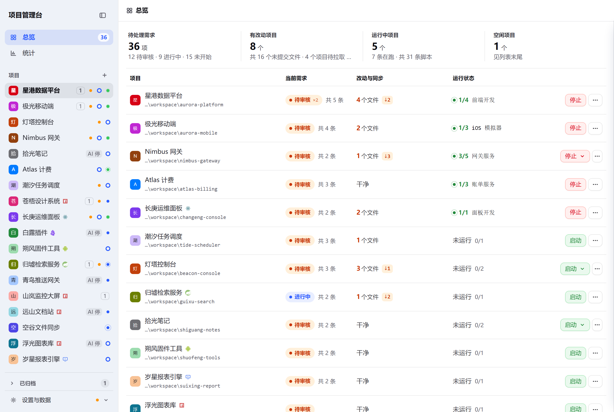
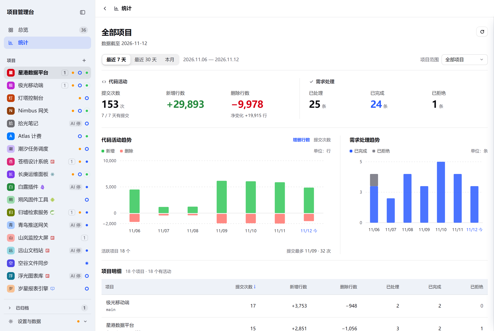
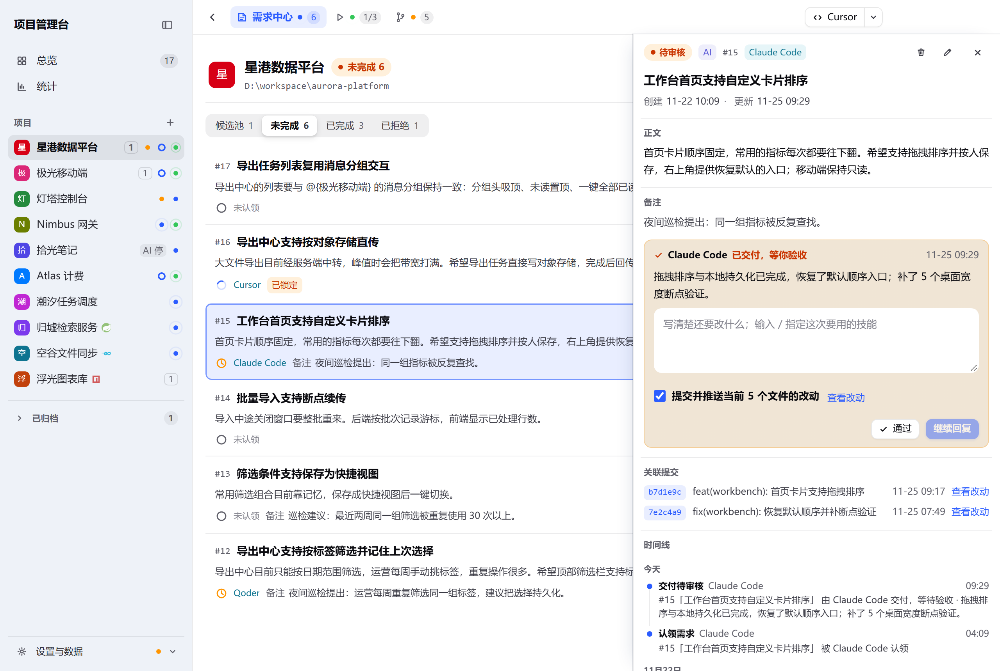
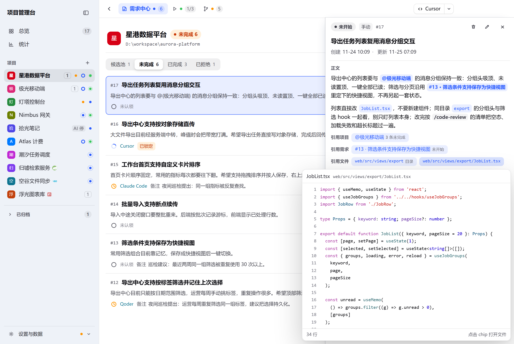
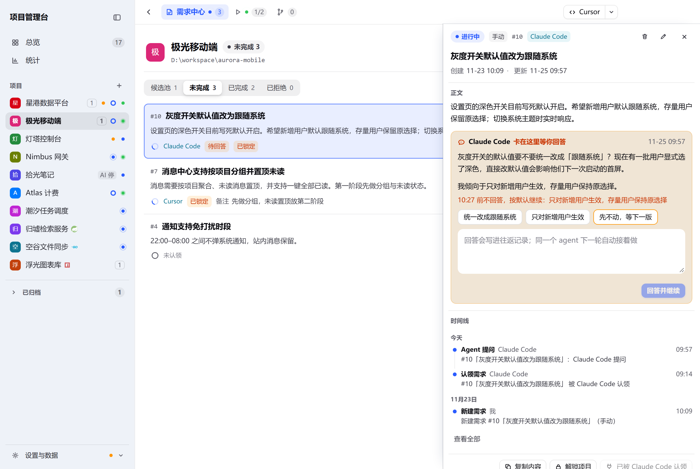
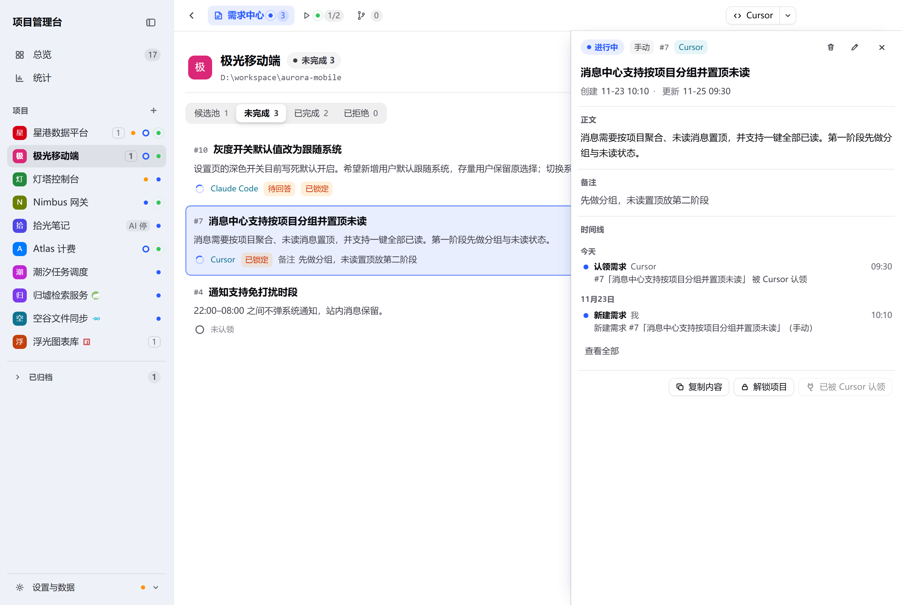
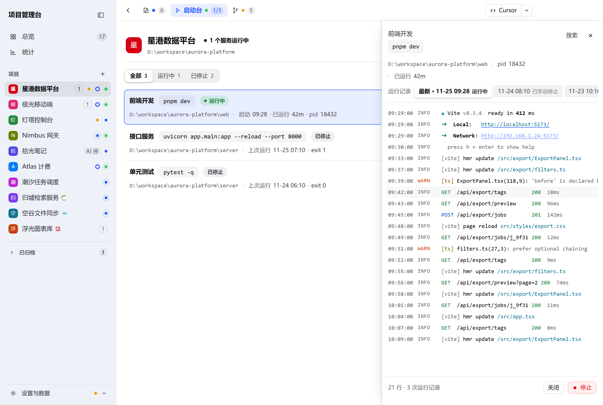
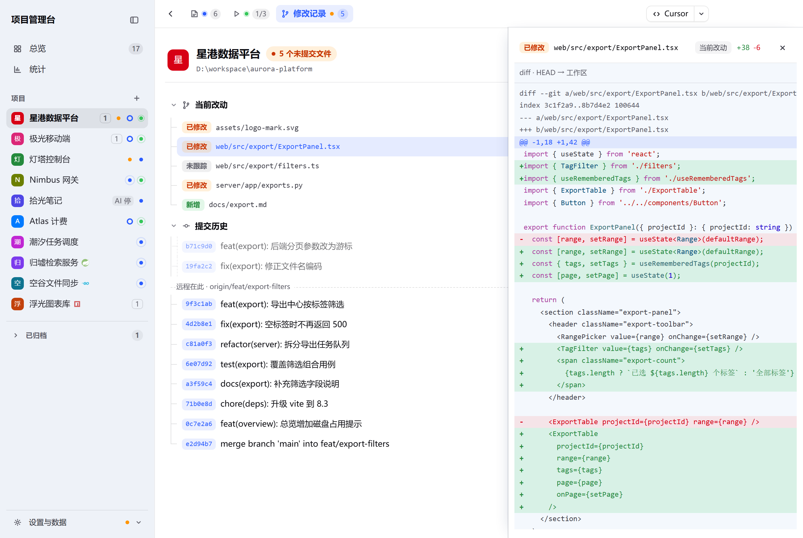

<p align="center">
  
</p>

<h1 align="center">项目管理台</h1>

<p align="center">给自己用的桌面项目管理台：一个窗口看完需求、命令和提交。</p>

<p align="center">
  <code>Electron 44</code> · <code>React 19</code> · <code>Vite 8</code> · <code>Node ≥ 20</code> · Windows / macOS / Linux
</p>

<p align="center">
  <a href="#界面">界面</a>
  &nbsp;·&nbsp;
  <a href="#功能">功能</a>
  &nbsp;·&nbsp;
  <a href="#ai-协作">AI 协作</a>
  &nbsp;·&nbsp;
  <a href="#快速开始">快速开始</a>
  &nbsp;·&nbsp;
  <a href="#文档">文档</a>
</p>

## 界面

<p align="center"><strong>统计 — 提交、行数与需求处理量，按 7 天 / 30 天 / 本月切换</strong></p>
<p align="center"></p>

<p align="center"><strong>需求中心 — 候选、进行中、待审核在同一条时间线上推进</strong></p>
<p align="center"></p>

<p align="center"><strong>需求详情 — 正文用 @ 引用其他项目、本项目需求与文件，用 / 引用技能；悬停就地查看需求或文件内容</strong></p>
<p align="center"></p>

<p align="center"><strong>Agent 提问 — 带候选答案和倒计时，你回一句它当场继续</strong></p>
<p align="center"></p>

<p align="center"><strong>Agent 认领 — 固定 AgentID，按项目串行，交付后等你验收</strong></p>
<p align="center"></p>

<p align="center"><strong>启动台 — 每个项目一组命令，每次运行单独留日志</strong></p>
<p align="center"></p>

<p align="center"><strong>修改记录 — 当前改动与提交历史一棵树，点开就地看 diff</strong></p>
<p align="center"></p>

## 功能

- **需求中心** — 候选池、未开始、进行中、待审核、已完成；AI 提的需求先进候选池，点了「采纳」才进队列。
- **让 agent 干活** — 本地 MCP 接入后，agent 能提需求、认领、交付、提问；认领与验收按项目串行，命令启停不对 AI 开放。
- **启动台** — 点一下跑本地进程，日志保留 ANSI 颜色；退出时可选择分离，应用关了进程继续跑。
- **修改记录** — 当前改动和提交历史在一棵树里，行内展开 diff；验收时可顺手提交并推送。
- **搜索与切换** — `Ctrl / ⌘ + K` 全局搜索（项目、需求、日志、提交都支持拼音），`+ O` 切项目，`+ P` 命令面板。
- **通知与审计** — 待审核、命令异常、AI 新需求会发系统通知；托盘角标显示待审核数；事件流可筛选。
- **手机端通信** — 经 ntfy 把「待审核」「待回答」推送或转发到手机；两端共用随机 topic 与连接密钥，消息本地 AES-256-GCM 加密，扫码即接入。协议见 [手机端通信](doc/mobile-link.md)。
- **备份与恢复** — 每日快照保留 7 天，恢复前先存一份当前库；有命令在跑时不允许恢复。
- **项目图标** — 自动识别 Android、Obsidian、IntelliJ、Electron、JavaFX、Spring Boot 的专属图标，否则回退首字母；项目名后跟技术栈图标。
- **桌面细节** — 拖拽排序、侧栏收起、深浅主题、项目悬停信息卡、安装版自动更新。

## AI 协作

本地 MCP 跑在 `127.0.0.1:7318`，开发版和打包版用同一份配置，接入只需要一条 URL：

```json
{
  "mcpServers": {
    "project-manager": {
      "url": "http://127.0.0.1:7318/mcp"
    }
  }
}
```

提供 4 个工具：`pm_list_projects`、`pm_get_project`、`pm_list_requirements`、`pm_create_requirement`。

执行 agent 通过动作接口协作：

| 动作 | 接口 | 说明 |
|---|---|---|
| 认领 | `GET /claim` | 一条需求只能被一个 agent 认领 |
| 取活 | `GET /next` | 取即认领，没有活时在服务端挂住等待 |
| 交付 | `POST /complete` | 进入待审核，请求最多等 30 分钟验收 |
| 提问 | `POST /ask` | 带候选与默认答案，最多等 5 分钟 |
| 释放 | `POST /release` | 做不下去时退回队列 |

认领按项目串行：有进行中需求、待审核交付或未提交改动都会挡住派发。agent 名称在「AI 接入 → Agent 管理」里登记，工作台分配固定 AgentID。巡检与执行手册由应用下发（`/prompt/scout.txt`、`/prompt/worker.txt`）。

## 技术栈

| 层 | 技术 |
|---|---|
| 桌面 | Electron 44 |
| 前端 | React 19, Vite 8 |
| 主进程 | Node.js（IPC + 本地 HTTP / MCP） |
| 数据 | 本地 JSON（`db.json` + `archive/`） |
| AI 接入 | MCP（`127.0.0.1:7318`） |

## 快速开始

```bash
npm install                 # Electron + 打包工具
npm --prefix web install    # 前端依赖
npm run dev                 # Vite HMR + Electron 窗口
```

```bash
npm run build               # 前端产物 → electron/renderer
npm start                   # 打开桌面窗口
npm run dist                # electron-builder → release/
```

发布：仓库 <https://github.com/BugStack27/project-manager>。改 `package.json` 的 `version` 后打同名 `v` 前缀标签，推送触发 GitHub Actions 构建安装包并挂到 Release；安装版靠该 Release 的 `latest.yml` 自动更新。

```bash
git tag v1.0.0              # 必须与 package.json 的 version 一致
git push origin v1.0.0
```

## 目录

```
electron/    主进程、IPC、本地 MCP、领域层与本地服务
web/         Vite + React 前端（五个页面、右面板、三栏壳层）
prompts/     AI 巡检与执行手册真源
doc/         设计决策记录与截图
```

## 文档

- [产品方案](doc/product-spec.md) · [架构与通道](doc/architecture-and-channels.md) · [壳层与导航](doc/app-shell-and-navigation.md) · [主题与身份色](doc/theme-and-identity-colors.md)
- [需求中心与 Agent 协作](doc/requirements-and-agent.md) · [自动派发与自动执行](doc/auto-dispatch.md) · [需求往返对话与提问](doc/requirement-thread.md) · [修改记录与 git 同步](doc/changes-and-git-sync.md)
- [总览与统计](doc/overview-and-statistics.md) · [启动台与命令运行](doc/launch-and-runs.md) · [项目登记与图标识别](doc/projects.md) · [搜索与快捷键](doc/search-and-shortcuts.md)
- [事件日志与通知](doc/event-log-and-notifications.md) · [系统运行与发布](doc/system-runtime-and-release.md) · [数据备份与恢复](doc/backup-and-restore.md) · [手机端通信](doc/mobile-link.md)
